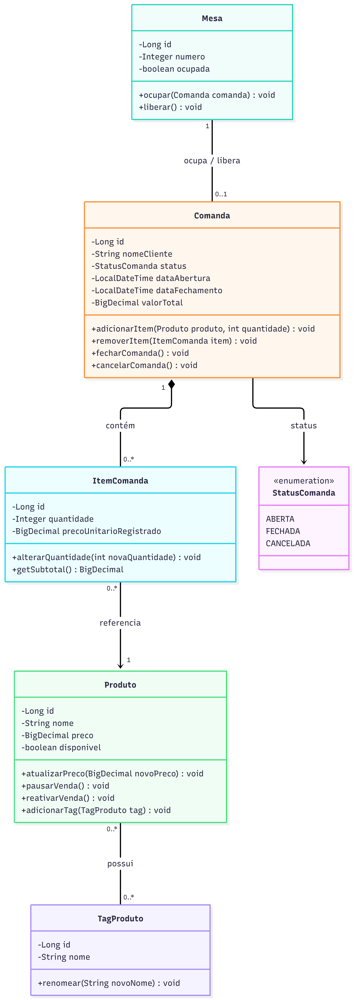

# ComandaDigital — Modelagem de Domínio, Arquitetura e API REST

Sistema de gestão de mesas, comandas e cardápio digital. O projeto contempla a modelagem rica do domínio com JPA/Hibernate, o diagrama de classes UML, a definição arquitetural e o desenvolvimento colaborativo das camadas de persistência, serviço e API REST.

## Arquitetura Escolhida: Arquitetura em Camadas (Layered Architecture)

Foi adotada a **Arquitetura em Camadas** tradicional do Spring Boot:
1. **Camada de Domínio (`domain`)**: Entidades JPA, enums, regras de negócio intrínsecas e validações de estado.
2. **Camada de Persistência (`repository`)**: Interfaces Spring Data JPA.
3. **Camada de Serviço (`service`)**: Orquestração de casos de uso, regras de negócio e transações.
4. **Camada de Apresentação/API (`controller`)**: Endpoints REST e DTOs.

### Justificativa da Escolha
- **Necessidades do Negócio:** Exige consistência transacional forte (cálculo automático de totais, bloqueio de edição em comandas fechadas e controle de ocupação de mesas), atendida pelo modelo de domínio rico com JPA.
- **Complexidade do Sistema:** Sistema de porte enxuto, onde arquiteturas distribuídas ou muito cerimoniosas (Hexagonal/Clean) adicionariam complexidade desnecessária.
- **Características da Equipe:** Desenvolvimento colaborativo em equipe de 3 integrantes, priorizando produtividade, padronização e facilidade de integração via Git/GitHub.

## Organização do Código

- `ComandadigitalApplication.java`: Classe principal do Spring Boot com `CommandLineRunner` para validação das regras de domínio e persistência em memória (H2).
- `domain/enums/StatusComanda.java`: Estados da comanda (`ABERTA`, `FECHADA`, `CANCELADA`).
- `domain/Mesa.java`: Controle de ocupação física (`@OneToOne` com `Comanda`).
- `domain/Comanda.java`: Agregado principal e cálculo de total (`@OneToMany` com `ItemComanda`).
- `domain/ItemComanda.java`: Registro de preço e quantidade (`@ManyToOne` com `Produto` e `Comanda`).
- `domain/Produto.java`: Catálogo de itens (`@ManyToMany` com `TagProduto`).
- `domain/TagProduto.java`: Etiquetas de categorização do cardápio.

## Divisão de Funcionalidades (Fluxo Git / Branches)

- **Vitor Rodrigo de Assis Cavalcanti Buarque** (`vRodrigoDev`): Modelagem de domínio, arquitetura base, diagrama UML, revisão de código e integração (`main`).
- **Abraão** (`abraao488`): Módulo de Catálogo e Tags (`repository`, `service` e `controller`) — branch `feature/catalogo-produtos`.
- **André Luiz Coelho** (`amdre2`): Módulo de Controle de Mesas (`repository`, `service` e `controller`) — branch `feature/controle-mesas`.

## Diagrama de Classes UML

## Instruções para Execução

1. Clonar o repositório: `git clone https://github.com/vRodrigoDev/comanda-digital-ATV.git`
2. Abrir em uma IDE Java (IntelliJ, Eclipse ou VS Code) com suporte a Maven e Java 17+.
3. Executar a classe `ComandadigitalApplication.java` para validar o carregamento das entidades JPA no banco H2 e os testes de regras de negócio no console.

## Integrantes do Grupo

- Vitor Rodrigo de Assis Cavalcanti Buarque (`vRodrigoDev`)
- Abraão (`abraao488`)
- André Luiz Coelho (`amdre2`)
